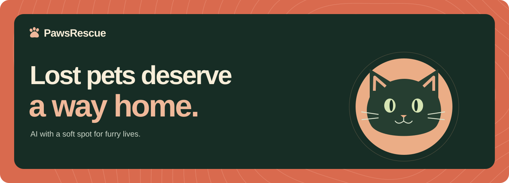
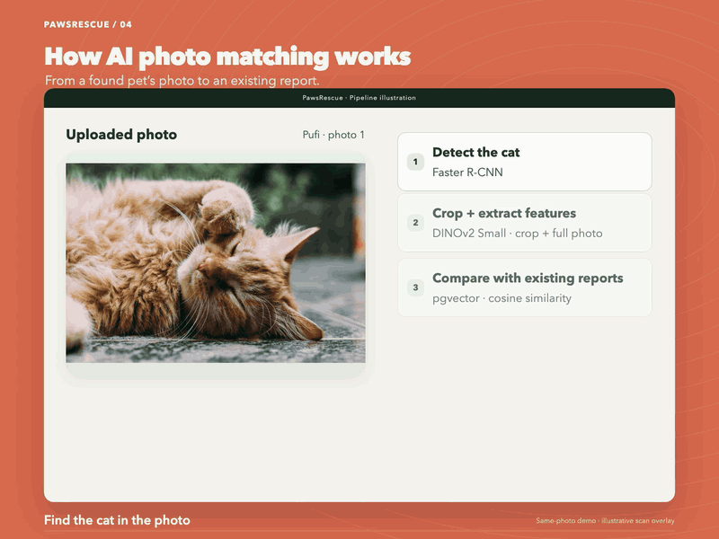
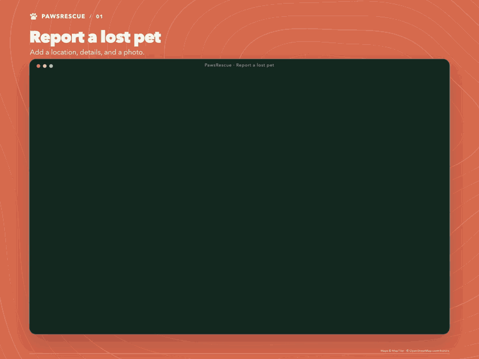
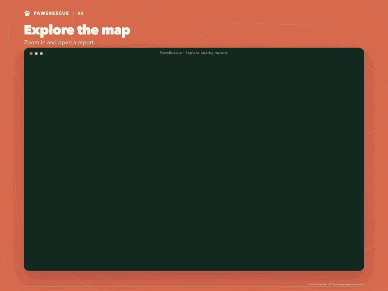
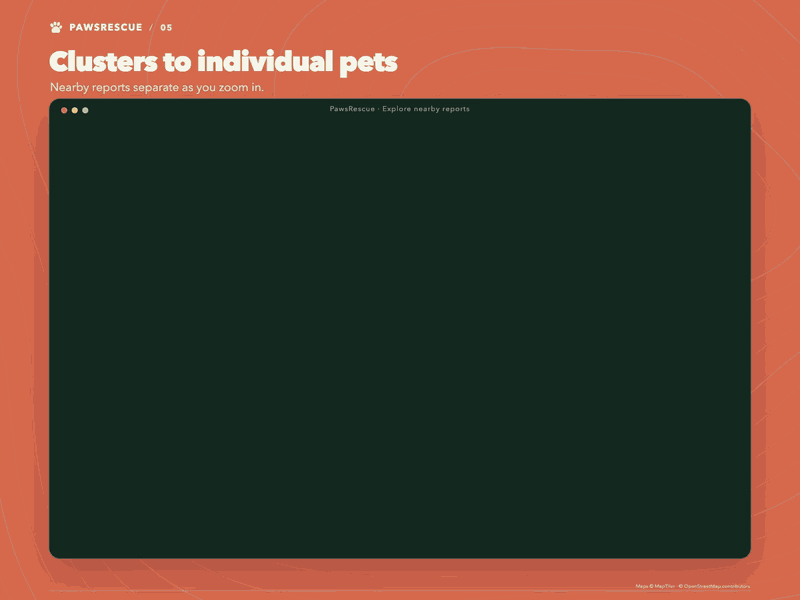

  

  <a href="#how-ai-photo-matching-works">AI matching</a> ·
  <a href="#demos">Demos</a> ·
  <a href="#help-finish-it">Contribute</a> ·
  <a href="docs/DEVELOPMENT.md">Run locally</a>

Photo matching for missing pets in Romania, built with **Faster R-CNN, DINOv2,
and pgvector**. Upload a photo of an animal you’ve found to look for similar
lost-pet reports, then check where each was last seen.

Reports live on a **MapTiler** map with place search, GPS positioning, and
clusters that open into individual pins as you zoom in. The app works in
Romanian and English.

I started it because lost-pet posts get buried across Facebook groups. I wanted
one place where the person looking for an animal and the person who found it
could find each other.

### How AI photo matching works

**Detect → crop → extract features → compare reports.** Faster R-CNN returns
a bounding box around the cat; the service crops that region. DINOv2 extracts
features from the crop and the full photo, which the service combines. PostgreSQL’s
pgvector extension ranks reports by cosine similarity. If no cat is detected,
the full photo is used.

The scan line is an explanatory animation, using a real detection and match.
It is not an extra screen in the app.

### Demos

#### Report a missing pet

#### Explore the map

#### From clusters to individual pets

**MapTiler SDK** handles the map and geocoding. Reports are returned as
**GeoJSON**, grouped by **Supercluster**. The client requests report data for
the visible map tiles and caches it as you pan.

#### Search using a photo

Local recordings with fictional reports, stock photos, and simulated GPS.
The photo search uses Pufi’s listing photo. [Demo notes and photo sources](docs/media/README.md).

Photo search suggests similar-looking animals; it does not confirm identity.
If no close results are found, try another photo or explore the map. See
[search behavior and setup](docs/DEVELOPMENT.md#photo-search-behavior).

### Help finish it

I don’t have much time to work on this anymore. The main flows work, but it’s
still a prototype. I’d like to find people who can help keep it going.

There’s plenty left: search filters, editing reports, email verification, and
marking animals as found. Help with design, translations, and testing would
be useful too.

[Open an issue](https://github.com/AndreiAyar/pawsrescue/issues) if you want to
help or have found something that needs fixing.

### Development

Next.js and React on the frontend, NestJS for the API, PostgreSQL with pgvector,
and a Python service for photo matching. The local demo uses DINOv2 Small.

[Local setup and commands](docs/DEVELOPMENT.md) ·
[Deployment](DEPLOY_DIGITALOCEAN.md)

License: not selected yet.
